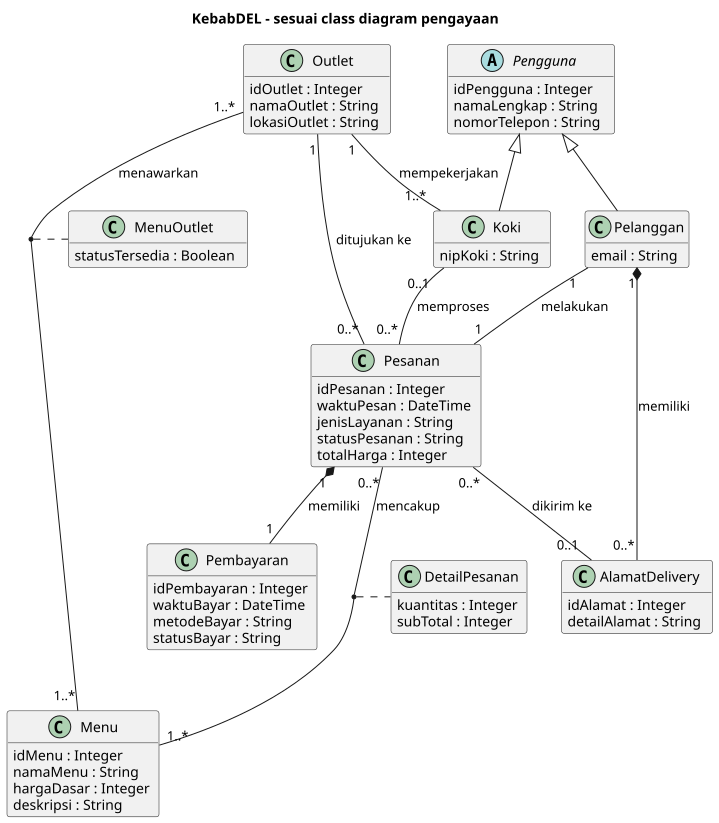

# KebabDEL - eksperimen MoTxT

Project Django untuk bagian MoTxT pada tugas Low Code Tool, disesuaikan dengan
class diagram pengayaan yang diberikan pada 24 November 2026.

## Jalankan

Lingkungan yang diuji: macOS, Python 3.14.2, Django 5.2.19, SQLite, Java 21.
Buat environment baru `.venv/`; folder `venv/` bawaan repo berasal dari Windows.

```bash
bash run.sh
```

Buka <http://127.0.0.1:8000/> atau <http://127.0.0.1:8000/dashboard/>.
Untuk data demo berelasi, jalankan di terminal terpisah:

```bash
.venv/bin/python manage.py seed_demo
```

Script startup memasang dependency, memeriksa konfigurasi, menerapkan migration
yang sudah tersedia, lalu menjalankan server. Tidak membuat migration otomatis.
Port alternatif: `bash run.sh 127.0.0.1:8001`. Windows: `run.bat` (belum diuji langsung).
Tampilan memakai Tailwind CDN dan Google Fonts sehingga perlu internet untuk gaya/font.

## Model sesuai diagram



- 10 class UML: `Pengguna` abstrak dan 9 class konkret.
- `Pelanggan` dan `Koki` mewarisi atribut `Pengguna`.
- Pelanggan–Pesanan **1:1**, sesuai diagram dan konfirmasi pengguna.
- Koki serta alamat pada pesanan opsional (0..1).
- `MenuOutlet` menyimpan ketersediaan per outlet.
- `DetailPesanan` menyimpan kuantitas/subtotal pada relasi pesanan–menu.
- Pembayaran memakai relasi 1:1 ke pesanan dan ikut terhapus bersama pesanan.

Class Kurir, NotaPesanan, Pengingat dan KuponDiskon dari output awal tidak masuk
model diagram yang diberikan. Halaman aktif hanya menampilkan 9 class konkret;
`Pengguna` abstrak tidak memiliki tabel atau halaman CRUD tersendiri.

Tabel data model lama tetap ada dengan awalan **`legacy_main_`**, melalui migration
`0002_archive_legacy_models`. Data tidak ditebak relasinya atau dihapus.
Migration `0003_diagram_kebabdel` membuat schema baru. Snapshot lokal sebelum
migrasi tersedia di `tmp/backups/before-diagram.sqlite3` pada workspace sesi ini.
Jangan menghapus database bila masih membutuhkan data lama.

## Generate ulang MoTxT

Sumber model: `diagrams/KebabDEL.uml` (UML/XMI), ditranskripsi dari gambar.
`diagrams/reference-class-diagram.png` menyimpan referensi yang diberikan.
`diagrams/KebabDEL.puml` dan `.svg` menyediakan visualisasi model yang sama.
Diagram 12 class hasil rekonstruksi awal dipisahkan di `diagrams/baseline/`.

Pasang Java serta extension MoTxT dan bigUML di VS Code. Pilih UML di sidebar MoTxT,
framework **Django**, target folder terpisah. Generator yang sama sudah dijalankan
melalui terminal:

```bash
.venv/bin/python scripts/generate_motxt.py
```

Jika perlu: `--jar /path/to/motxt.jar`. Output mentah berada di
`generated/diagram/Django/KebabDEL/`, terpisah dari project utama.
**Generate berhasil, tetapi hasil mentah belum bisa dijalankan tanpa perbaikan.**
Perintah juga menguji output mentah dan mencatat kegagalan pada `docs/evidence/`.
Perbaikan abstract inheritance, relasi, association class, form dan CRUD berada
pada project utama. Jangan menimpa project utama dengan hasil generate mentah.
Pembukaan/layout dalam editor bigUML belum diuji pada sesi ini.

## Verifikasi dan laporan

```bash
.venv/bin/python manage.py check
.venv/bin/python manage.py makemigrations --check --dry-run
.venv/bin/python manage.py test --verbosity 2
```

11 test mencakup CRUD 9 entitas, inheritance, FK, optionality, association class,
constraint 1:1/unique, composition, validasi input, CSRF, protected delete,
seed berulang, serta preservasi data saat migration. Database test terpisah.

Baca [catatan eksperimen](docs/eksperimen-motxt.md) untuk temuan generator, batasan,
langkah demo, dan tabel perbandingan Besser yang masih menunggu hasil rekan kelompok.
Aplikasi ini prototipe CRUD; minimum jumlah anggota relasi `1..*` dan alur bisnis
OVO lengkap belum otomatis diterapkan hanya dengan model Django.

Perubahan tetap lokal; belum di-commit atau di-push. Artefak runtime yang sudah
terlanjur dilacak commit awal tetap ada; `.gitignore` mencegah artefak lokal baru.
