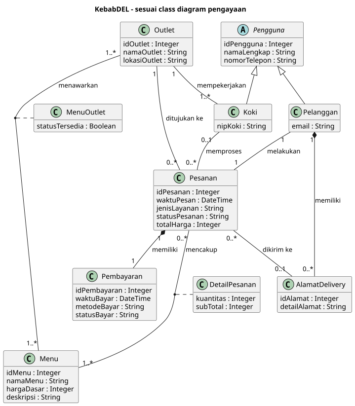

# Eksperimen MoTxT - KebabDEL

Tanggal: Selasa, 24 November 2026 (WIB). Presentasi: Rabu, 25 November 2026.
Nama/NPM dua anggota MoTxT diisi kelompok. Dua anggota lain mengerjakan Besser;
hasil Besser belum diterima dan tidak dikarang pada laporan ini.

## Tujuan dan acuan

Menggunakan class diagram pengayaan KebabDEL untuk generate Django melalui MoTxT,
menjalankan aplikasi, serta mencatat kebutuhan perbaikan hasil generate.
Acuan utama model adalah gambar class diagram yang diberikan pengguna, tersimpan
pada `diagrams/reference-class-diagram.png`. Narasi kasus berasal dari
`KebabDEL - BPMN & AD Study Case.pdf`; materi `15. Model Driven SE.pdf`
halaman 47 mencantumkan MoTxT. Instruksi pekerjaan mengikuti permintaan pengguna.

Repo awal memiliki 12 model scalar tanpa relasi. Setelah diagram asli tersedia,
model disesuaikan menjadi 10 class UML berikut. Baseline rekonstruksi awal disimpan
terpisah pada `diagrams/baseline/` dan bukan model final eksperimen.

## Model eksperimen

| Class | Atribut pada gambar |
| --- | --- |
| Pengguna (abstract) | idPengguna, namaLengkap, nomorTelepon |
| Pelanggan | email; mewarisi Pengguna |
| Koki | nipKoki; mewarisi Pengguna |
| AlamatDelivery | idAlamat, detailAlamat |
| Outlet | idOutlet, namaOutlet, lokasiOutlet |
| Menu | idMenu, namaMenu, hargaDasar, deskripsi |
| Pesanan | idPesanan, waktuPesan, jenisLayanan, statusPesanan, totalHarga |
| Pembayaran | idPembayaran, waktuBayar, metodeBayar, statusBayar |
| DetailPesanan (association class) | kuantitas, subTotal |
| MenuOutlet (association class) | statusTersedia |

Gambar tidak mencantumkan tipe atribut. Untuk input generator dipilih Integer
untuk ID/jumlah/harga, String untuk teks, DateTime untuk waktu, dan Boolean untuk
ketersediaan. Nama camelCase di UML dipetakan menjadi snake_case di Django.
Pemilihan tipe ini merupakan keputusan implementasi, bukan informasi yang tertulis
pada gambar. Nomor telepon dan NIP berupa teks agar nol di awal tetap dipertahankan.

| Relasi pada gambar | Pemetaan project utama |
| --- | --- |
| Pengguna digeneralisasi menjadi Pelanggan dan Koki | Abstract Django model; atribut diwariskan ke dua tabel konkret |
| Pelanggan 1 — 0..* AlamatDelivery (composition) | FK pelanggan pada alamat, CASCADE |
| Pelanggan 1 — 1 Pesanan | Satu OneToOneField pelanggan pada pesanan; reverse relation otomatis |
| Koki 0..1 — 0..* Pesanan | FK koki pada pesanan, nullable dan blank |
| Outlet 1 — 1..* Koki | FK outlet pada koki |
| Outlet 1 — 0..* Pesanan | FK outlet pada pesanan |
| AlamatDelivery 0..1 — 0..* Pesanan | FK alamat pada pesanan, nullable dan blank |
| Pesanan 1 — 1 Pembayaran (composition) | Satu OneToOneField pada pembayaran, CASCADE |
| Pesanan 0..* — 1..* Menu | ManyToMany melalui DetailPesanan, dengan kuantitas/sub_total |
| Outlet 1..* — 1..* Menu | ManyToMany melalui MenuOutlet, dengan status_tersedia |

**Pelanggan–Pesanan tetap 1:1**, mengikuti gambar dan konfirmasi eksplisit pengguna.
Artinya pelanggan yang sama tidak bisa memiliki dua pesanan pada prototipe ini.
Tidak diubah menjadi 1:N meskipun narasi kasus menyebut riwayat pembelian.
Kurir, NotaPesanan, Pengingat, dan KuponDiskon tidak dimasukkan karena tidak ada pada
diagram acuan. Fitur narasi kasus yang tidak tercakup diagram tidak ditambahkan diam-diam.

## Prosedur dan hasil generate

Lingkungan: macOS, Python 3.14.2, Django 5.2.19, SQLite, OpenJDK 21.0.10,
MoTxT extension 1.0.5, bigUML extension 0.5.1.

1. Transkripsikan class, inheritance, multiplicity, composition, dan association class
   dari gambar menjadi `diagrams/KebabDEL.uml`, format UML2/XMI.
2. Jalankan generator Java dari extension MoTxT, memakai entry point yang sama
   dengan sidebar VS Code: `id.ac.ui.cs.ppl.motxt.main.Generate`.
3. Pilih framework Django; simpan output terpisah di `generated/diagram/Django/KebabDEL/`.
4. Periksa hasil mentah menggunakan `manage.py check`.
5. Perbaiki project utama, terapkan migration, isi data demo berelasi, uji Django dan browser.

Generator selesai dengan pesan `Generated`. Output mencakup model, form, view, URL,
template CRUD, konfigurasi dan script startup. **Hasil mentah gagal startup**, dengan
`NameError: name 'Pesanan' is not defined`. Jadi keberhasilan generate tidak berarti
aplikasi hasil generate langsung bebas error.

Bukti yang dapat ditinjau:

- `docs/evidence/motxt-models.py.txt`: salinan model mentah hasil generate final.
- `docs/evidence/motxt-check.txt`: hasil check output mentah, exit code 1 beserta traceback.
- `docs/evidence/verification.txt`: hasil verifikasi project utama setelah perbaikan.

Pengujian generator dilakukan melalui terminal, bukan klik sidebar VS Code.
File UML berhasil diproses MoTxT; pengeditan dan layout visual dalam bigUML belum diuji.

## Temuan generator dan koreksi manual

| Temuan dari output mentah | Koreksi pada project utama |
| --- | --- |
| Referensi ke Pesanan/Menu/Pembayaran sebelum class didefinisikan | Susun deklarasi dan gunakan string reference pada relasi forward |
| Pengguna tidak diberi Meta.abstract meskipun UML isAbstract=true | Jadikan Pengguna abstract agar tidak punya tabel/CRUD sendiri |
| One-to-one dideklarasikan di kedua sisi | Simpan satu field pada sisi yang sesuai, gunakan reverse accessor Django |
| Koki/alamat pada Pesanan tidak nullable meskipun UML 0..1 | Tambahkan null=True dan blank=True |
| DetailPesanan dan MenuOutlet masing-masing dideklarasikan dua kali | Gabungkan field relasi dan atribut association class dalam satu model |
| Deklarasi terakhir association class menimpa kuantitas/sub_total/status_tersedia | Pertahankan seluruh atribut pada through model |
| Many-to-many dideklarasikan ulang pada kedua sisi | Satu ManyToManyField melalui through model; reverse relation otomatis |
| Composition tidak memetakan arah kepemilikan secara konsisten | Pembayaran/details ikut terhapus bersama pesanan; alamat ikut pelanggan |
| CRUD scalar awal tidak cocok dengan model berelasi dan abstract class | Registry 9 class konkret, template list/form bersama, dropdown FK dan prefill dari instance |

Pemeriksaan source menunjukkan masalah selain NameError; urutan startup berhenti
pada NameError pertama. Tidak diklaim bahwa semua error di tabel muncul sebagai
traceback terpisah. Temuan berlaku untuk versi dan input eksperimen ini.

Koreksi tambahan untuk demonstrasi: ID bisnis unique, harga/jumlah nonnegatif,
kuantitas minimal 1, pasangan pesanan–menu dan outlet–menu unique, email tervalidasi,
label objek relasi terbaca, CSRF, ID salah mendapat 400/404, dan penghapusan record
yang masih dipakai mendapat halaman pesan HTTP 409. Validasi form memeriksa alamat
milik pelanggan, koki dari outlet yang dipilih, serta menu yang ditawarkan outlet.
Validasi lintas relasi ini berada pada form CRUD; penulisan langsung lewat ORM dapat
melewatkannya. Koreksi ini manual, bukan kemampuan yang terbukti dihasilkan otomatis.

## Migrasi dan data demo

`0002_archive_legacy_models` mengganti nama 12 tabel lama menjadi `legacy_main_*`,
lalu melepas model lama dari state migration tanpa menghapus tabel database.
`0003_diagram_kebabdel` membuat schema baru. Relasi data lama tidak ditebak karena
model awal tidak menyimpan foreign key. Tabel arsip tidak tampil di halaman CRUD.
Snapshot SQLite sebelum migration disimpan lokal pada `tmp/backups/before-diagram.sqlite3`.

Command `seed_demo` membuat satu graph terhubung dengan total 9 record konkret:
pelanggan, alamat, outlet, koki, menu, ketersediaan per outlet, pesanan, detail,
dan pembayaran. Data fiktif; OVO hanya teks simulasi. Command dapat diulang tanpa
menimpa nilai record yang sudah ada. Pembayaran tidak benar-benar dikirim ke OVO.

## Verifikasi

| Pemeriksaan | Hasil |
| --- | --- |
| Generate UML final melalui Java MoTxT | Berhasil, output mentah tersimpan |
| Check project mentah | Gagal dengan NameError; tercatat sebagai temuan |
| Check project utama setelah koreksi | Tidak ada masalah |
| Migration project utama | 0002 dan 0003 berhasil diterapkan |
| Makemigrations check | No changes detected |
| Test suite | 11 test lulus; CRUD diuji untuk semua 9 class konkret |
| Inheritance | Pengguna abstract; tabel pengguna tidak dibuat |
| Association class | Atribut tersimpan; relasi M2M dapat ditelusuri; pasangan unik |
| Constraint 1:1 | Pelanggan yang sama tidak dapat dibuatkan dua pesanan; satu pesanan tidak punya dua pembayaran |
| Optionality | Pesanan pickup dapat dibuat tanpa alamat/koki |
| Composition/protected delete | Cascade sesuai pemetaan; record yang masih dipakai ditolak tanpa HTTP 500 |
| Migrasi data awal | Test historis memastikan record lama tetap ada di tabel arsip |
| Browser lokal | Dashboard 9 entitas; daftar dan form edit DetailPesanan menampilkan Pesanan 9001, Kebab Sapi Demo, kuantitas 2 dan subtotal 50000 |

Semua test menggunakan database sementara. Server development project utama
berjalan pada `http://127.0.0.1:8000/`. Windows belum diuji langsung.

## Batasan yang perlu disampaikan

Minimum satu anak pada relasi `1..*` belum dipaksakan oleh CRUD terpisah. Outlet dapat
sementara belum memiliki koki/menu, menu belum memiliki outlet, dan pesanan dapat
sementara belum memiliki detail/pembayaran. FK/OneToOne memastikan sisi anak dan
batas maksimum, tetapi tidak menjamin setiap parent langsung punya anak. Pembuatan
parent beserta seluruh anak secara atomik memerlukan form gabungan atau service tambahan.
Karena itu pemetaan ini belum menegakkan semua lower bound secara penuh.

Ini eksperimen kerangka CRUD, belum aplikasi pemesanan lengkap. Tidak ada integrasi
OVO/timeout dua menit, proses memasak/delivery, WhatsApp/Telegram, notifikasi ponsel,
unduh nota JPG, pesan ulang, promo, atau otorisasi aktor. Style/font menggunakan CDN.
Hasil uji tidak menjamin seluruh kemungkinan input/alur bisnis bebas error.

## Panduan demo kelas

1. Tunjukkan gambar acuan dan UML: jelaskan abstract inheritance, 1:1, 0..1, dan association class.
2. Jalankan `scripts/generate_motxt.py`; tunjukkan output `Generated` serta check mentah yang gagal.
3. Perlihatkan contoh deklarasi association class ganda dan perubahan manual di model utama.
4. Jalankan `bash run.sh`, lalu `seed_demo`. Buka dashboard 9 entitas.
5. Buka MenuOutlet untuk melihat ketersediaan per outlet, lalu DetailPesanan untuk kuantitas/subtotal.
6. Edit record demo; tunjukkan dropdown relasi yang terisi. Gunakan record demo baru untuk mencoba hapus.
7. Tunjukkan 11 test lulus dan jelaskan batasan lower bound serta relasi Pelanggan–Pesanan 1:1.
8. Gabungkan temuan dengan hasil dua anggota Besser untuk perbandingan akhir.

## Lembar perbandingan Besser

| Aspek | MoTxT, input diagram final | Besser |
| --- | --- | --- |
| Input | UML/XMI, 10 class, abstract inheritance dan association class | Diisi dari model yang sama |
| Jalur generate | Generator Java extension 1.0.5 | Diisi anggota Besser |
| Output | Model, form, view, URL, template CRUD, settings, script startup | Diisi anggota Besser |
| Startup output mentah | Gagal NameError | Uji dan catat hasil aktual |
| Abstract inheritance | Perlu koreksi manual | Periksa output |
| Association class dan atribut | Perlu menggabungkan deklarasi ganda | Periksa atribut dan relasi |
| Optionality dan composition | Perlu koreksi manual | Uji dengan kasus yang sama |
| Setelah koreksi | Django berjalan, 11 test lulus | Catat perbaikan dan pengujian |
| Lower bound 1..* | Belum ditegakkan penuh pada CRUD | Uji dan catat |
| Lama pengerjaan | Tidak diukur, tidak dibuat-buat | Diisi jika diukur |

Kesimpulan bagian MoTxT: transformasi model final berhasil menghasilkan kerangka
Django, tetapi output pada versi/input ini memerlukan koreksi manual sebelum dapat
berjalan dan mempertahankan semantics diagram. Perbandingan aktual dengan Besser
menunggu hasil rekan kelompok.
